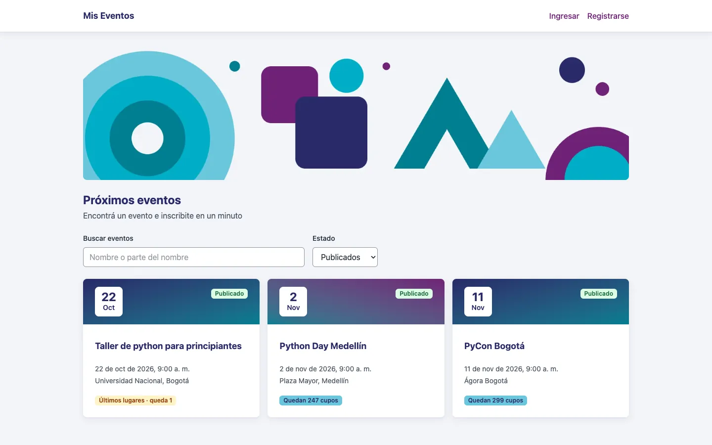
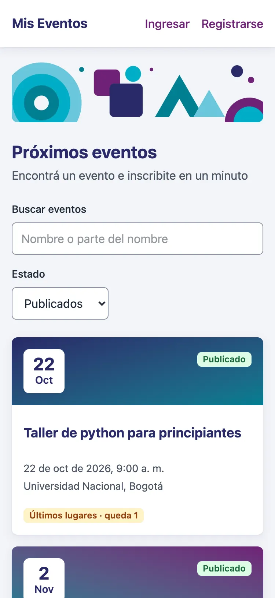
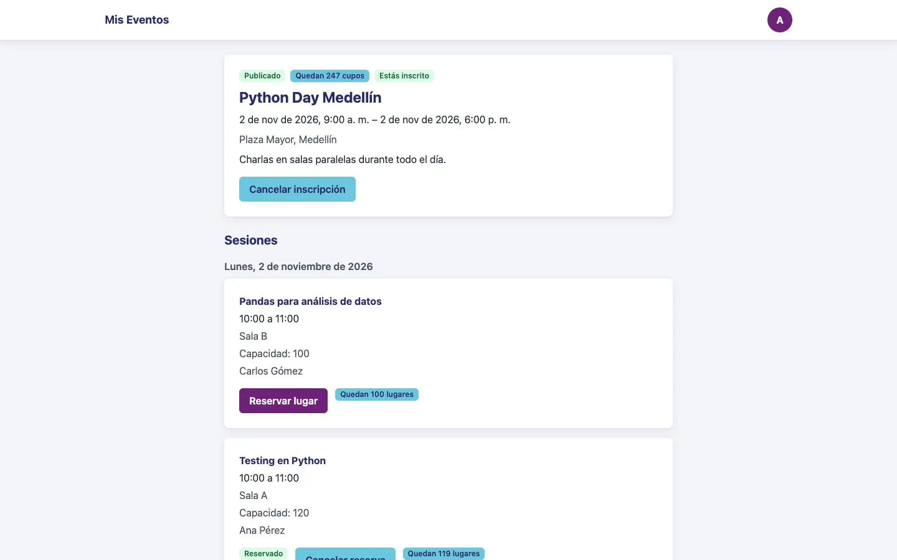
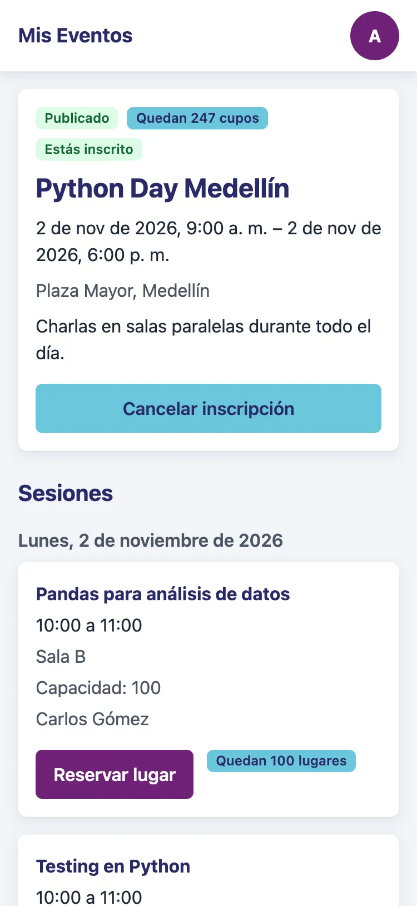

# Mis Eventos — frontend

Interfaz web de Mis Eventos: listado y detalle de eventos, inscripciones, reservas de sesiones, perfil y administración de usuarios. Todo el texto está en español y las fechas se muestran en hora de Bogotá (`America/Bogota`).

Stack: React 19, TypeScript, Vite, React Router, Zustand, Tailwind CSS 4. Tests con Vitest, Testing Library y MSW.

## Requisitos

- Node.js 24 (`engines` pide `>=24 <25`).
- npm.
- La API de Mis Eventos corriendo. El frontend de desarrollo no trae datos de prueba: habla con la API real.

## Configurar

```bash
cd frontend
npm ci
```

Una sola variable de entorno:

| Variable | Para qué sirve | Por defecto |
|---|---|---|
| `VITE_API_URL` | URL base de la API | `http://localhost:8000` |

Vite la lee al arrancar y al compilar. Con `VITE_API_URL=http://localhost:8000 npm run dev` o en un archivo `.env.local` dentro de `frontend/`. En Docker se pasa como argumento de build y también se usa en la política de seguridad de contenido (`connect-src`) de `nginx.conf.template`.

## Ejecutar

```bash
npm run dev       # servidor de desarrollo en http://localhost:5173
npm run build     # comprueba los tipos (tsc -b) y compila a dist/
npm run preview   # sirve dist/ en http://localhost:4173
```

Con todo el entorno en Docker (base, API y frontend) desde la raíz del repo: `docker compose up --build`. El frontend queda en `http://localhost:5173`.

## Probar y lint

```bash
npm test              # Vitest en modo observador
npm test -- --run     # una sola pasada
npm run test:cov      # una pasada con cobertura
npm run lint          # ESLint, sin advertencias permitidas
npx tsc -b            # solo tipos
```

- `test:cov` exige 80 % mínimo en líneas, funciones, ramas y sentencias. Si un test falla, no escribe el informe.
- El informe HTML queda en `coverage/index.html` (abrilo en el navegador). Esa carpeta no se sube al repo.
- Los tests usan MSW con tipos generados del OpenAPI: un mock que no coincide con la API no compila.

## Estructura de carpetas

```
src/
├── api/             Cliente HTTP (fetch), ApiError, navegación al login y tipos generados (schema.d.ts)
├── components/      Componentes de dominio: tarjeta de evento, formularios, sesiones, inscripciones, encabezado
│   └── ui/          Componentes base sin lógica de negocio: botón, campos, diálogos, tabla, avisos, etc.
│       └── iconos/  Íconos SVG
├── lib/             Funciones y hooks sin pantalla: fechas, plurales, ?next=, carga de evento y sesiones, errores de formulario
├── pages/           Una carpeta por pantalla (Inicio, Login, EventoDetalle, AdminUsuarios, …)
├── stores/          Estado global con Zustand: sesión y caché del listado de eventos
├── test/            Ayudas de los tests: render con router, datos de ejemplo y respuestas de MSW tipadas
├── App.tsx          Rutas y carga diferida de pantallas
├── main.tsx         Punto de entrada
└── index.css        Tailwind y el tema (@theme)
```

Los tests viven junto al archivo que prueban (`Algo.tsx` y `Algo.test.tsx`).

## Rutas

| Ruta | Pantalla | Requiere sesión | Permiso |
|---|---|---|---|
| `/` | Inicio: listado de eventos con búsqueda, filtro de estado y paginación | No | Ninguno. Los borradores solo se ofrecen con `evento:crear` |
| `/login` | Iniciar sesión | No | Ninguno |
| `/registro` | Crear cuenta | No | Ninguno |
| `/eventos/:id` | Detalle del evento, sesiones, inscripción y reservas | No | Ninguno. Las acciones del dueño las ve su organizador o quien tenga `evento:gestionar_todos` |
| `/eventos/nuevo` | Crear evento | Sí | `evento:crear` |
| `/eventos/:id/editar` | Editar evento | Sí | Ser el organizador del evento o tener `evento:gestionar_todos` |
| `/perfil` | Datos de la cuenta y mis inscripciones | Sí | Ninguno |
| `/cambiar-contrasena` | Cambiar contraseña. Con una contraseña temporal pendiente, es la única pantalla a la que se llega | Sí | Ninguno |
| `/admin/usuarios` | Administración de usuarios: alta con contraseña temporal, edición y restablecimiento de contraseña | Sí | `usuarios:gestionar` |
| `*` | Página no encontrada | No | Ninguno |

Cómo se aplica:

- Todas las rutas van dentro de `ExigirCambioDeContrasena`: con sesión vigente y `must_change_password`, cualquier ruta lleva a `/cambiar-contrasena`.
- Las rutas con sesión van dentro de `RutaProtegida`. Sin sesión vigente llevan a `/login?next=<ruta>`.
- Quien tiene sesión pero no el permiso ve un aviso en la misma pantalla ("No tenés permiso…"). La decisión final la toma siempre la API.
- Los permisos los calcula la API y llegan con el usuario (`/auth/me`). El cliente solo los lee.
- `?next=` solo acepta rutas internas: empieza con `/` y no con `//` ni `/\`. Si no, se vuelve a `/`.

## Componentes reutilizables

Las pantallas no escriben estilos sueltos: todo color, espaciado y tipografía sale de estos componentes o del tema.

### Base (`components/ui/`)

| Componente | Para qué sirve | Props principales |
|---|---|---|
| `Button` | Botón de acción | `variante` (`primario`, `secundario`, `peligro`), `loading`, `ancho` |
| `EnlaceBoton` | Navega, pero con aspecto de botón | `to`, `variante`, `ancho` |
| `Enlace` | Enlace de texto, de navegación, de tarjeta o de marca | `to`, `variante` |
| `BotonIcono` | Acción por fila: ícono con tooltip (en angosto, ícono y texto) | `etiqueta` (nombre accesible), `texto`, `icono`, `variante`, `soloIcono` |
| `MenuAcciones` | Menú de botón con teclado completo (flechas, Inicio, Fin, Escape) | `etiqueta`, `items` (`texto`, `onSelect` o `to`, `peligro`, `separado`), `titulo`, `subtitulo`, `variante`, `alinear`, `ocupado` |
| `Input`, `Textarea`, `Select` | Campos con label visible y `aria-invalid` | `label`, `error` y los atributos nativos |
| `Formulario`, `GrupoCampos` | Separación estándar entre bloques y campos | `children` |
| `Spinner` | Indicador de carga con `role="status"` | `className`, `heredar` |
| `Toast` | Un aviso: `role="status"`, o `alert` si es de error | `message`, `tone` (`exito`, `error`, `info`), `onClose` |
| `ProveedorAvisos`, `useAvisos` | Apila los avisos de toda la app (máximo 3, 4 s cada uno) | `useAvisos()` devuelve `avisar({ message, tone })` |
| `AlertaError` | Error de una pantalla con `role="alert"` | `title`, `detail` |
| `EstadoVacio` | Mensaje de lista vacía con una acción | `mensaje`, `accion`, `onAccion` |
| `Chip` | Estado o etiqueta corta, siempre con texto | `tono`, `onQuitar`, `etiquetaQuitar` |
| `DialogoConfirmacion` | Confirma una acción; el foco arranca en "Volver" | `titulo`, `mensaje`, `confirmar`, `variante` (`primario` o `peligro`, por defecto `peligro`), `cargando`, `onConfirmar`, `onVolver` |
| `ImagenPortada` | Ilustración decorativa de la cabecera del inicio, con `srcset` y tamaño fijo | — |
| `Modal` | Diálogo para un formulario; Escape cierra | `titulo`, `onCerrar` |
| `Monoespaciado` | Un valor que se lee carácter por carácter o se copia (una contraseña, un código), seleccionable de un clic | `children` |
| `Paginacion` | Anterior, "Página N de M" y Siguiente; no se muestra con una sola página | `pagina`, `paginas`, `onCambiar` |
| `Pestanas` | Pestañas con flechas del teclado | `etiqueta`, `pestanas`, `activa`, `onCambiar` |
| `Tabla` | Tabla en escritorio; en móvil, bloques apilados con la etiqueta de cada columna | `descripcion`, `columnas`, `filas` |
| `Tarjeta` | Superficie con sombra y entrada escalonada | `as`, `indice`, `cabecera` |
| `FranjaFecha` | Cabecera de tarjeta con día y mes | `dia`, `mes`, `gradiente` |
| `Pagina`, `TituloPagina` | Contenedor de cada pantalla y su `h1` | `ancho` (`angosto`, `medio`, `ancho`) |
| `TituloSeccion`, `TextoSecundario` | Títulos y texto de apoyo | `nivel`, `estilo`; `pequeno` |
| `Lista`, `ListaDatos`, `Cifra`, `BarraProgreso`, `Tooltip` | Listas con nombre accesible, pares etiqueta y valor, dato destacado, barra de ocupación y rótulo corto. El `Tooltip` se dibuja en un portal sobre el `body`, así ninguna tabla con overflow lo recorta | ver el archivo de cada uno |
| `IconoLlave` (en `iconos/`) | Ícono de "Restablecer contraseña" en la tabla de usuarios | — |

### De dominio (`components/`)

| Componente | Para qué sirve | Props principales |
|---|---|---|
| `EventoCard` | Tarjeta de un evento en el listado y en "Mis inscripciones" | `evento`, `indice`, `children` |
| `InsigniaEstado` | Chip del estado del evento (Borrador, Publicado, En curso, Cancelado, Finalizado) | `evento`, `etiquetaCancelado` |
| `ChipCupos` | Chip único de cupos o lugares ("Sin cupos", "Últimos lugares", "Quedan N cupos") | `capacidad`, `libres`, `unidad`, `soloConteo` |
| `FormularioEvento` | Crear o editar un evento; muestra los errores 422 junto a cada campo | `evento` (si viene, edita) |
| `FormularioSesion` | Crear o editar una sesión, con sus ponentes | `evento`, `sesion`, `onGuardada`, `onCancelar` |
| `FormularioUsuario` | Editar nombre, correo, rol y estado de un usuario (administración) | `usuario`, `propio`, `onGuardado`, `onCancelar` |
| `FormularioNuevoUsuario` | Crear un usuario con correo, nombre y rol; al crearlo muestra su contraseña temporal | `onCreado` (la lista se actualiza aunque el diálogo siga abierto), `onCerrar` |
| `RestablecerContrasena` | Confirma el restablecimiento de la contraseña de un usuario y muestra la temporal nueva | `usuario`, `onTerminado` |
| `DialogoContrasenaTemporal` | Muestra una contraseña temporal con "Copiar" y el aviso de que no se vuelve a mostrar. Vive solo mientras el diálogo está abierto: no pasa por ningún store | `nombre`, `contrasena`, `onCerrar` |
| `SelectorPonentes` | Busca ponentes (con espera de 300 ms), los agrega como chips y permite crear uno nuevo | `seleccionados`, `onChange`, `error` |
| `SeccionSesiones` | Lista de sesiones del evento con crear, editar, eliminar y reservar | `sesiones`, `evento`, `puede`, `inscrito`, `eventoPublicado`, `onGuardada`, `onEliminada`, `onReserva`, `onRefrescar` |
| `ControlReserva` | Reservar o cancelar la reserva de una sesión, según inscripción y cupo | `sesion`, `inscrito`, `eventoPublicado`, `trabajando`, `onReservar`, `onCancelar` |
| `SesionesReservadas` | Sesiones reservadas dentro de una inscripción | `evento`, `sesiones` |
| `MisInscripciones` | Pestañas Próximos, Pasados y Cancelados con paginación | — |
| `PanelInscripciones` | Estadísticas e inscritos de un evento (dueño o administrador) | `eventoId`, `version` |
| `useInscripcion` | Lógica de inscribirse y cancelar la inscripción, con su diálogo | `evento`, `onEvento`, `onRefrescar`, `reservas`, `onCancelada` |
| `Encabezado` | Marca, "Crear evento" (con `evento:crear`), ingreso y menú de cuenta | — |
| `RutaProtegida` | Deja pasar solo con sesión vigente | — |
| `ExigirCambioDeContrasena` | Con la contraseña temporal pendiente, lleva toda ruta a `/cambiar-contrasena` | — |

## Estado

Hay dos stores de Zustand (`src/stores/`).

**`session`** guarda:

- `user`: el perfil con sus permisos.
- `accessToken`: el token de acceso.
- `expiresAt`: cuándo vence (ms desde epoch), calculado con `expires_in`.
- `saliendo`: `true` tras un cierre voluntario, para que no se recuerde adónde volver.

Se persiste en `localStorage` con la clave `sesion`: `user`, `accessToken` y `expiresAt`. `saliendo` no se persiste. `useSesionVigente` vacía la sesión si el token ya venció.

El cambio obligatorio de contraseña vive en `user.must_change_password`, que llega con `/auth/me`. `exigirCambioDeContrasena()` lo pone en `true` cuando la API responde `password-change-required`; al cambiar la contraseña, la sesión se vuelve a iniciar con el token nuevo y `must_change_password: false`. Las contraseñas temporales que ve el admin no pasan por ningún store: viven en el estado del diálogo y se pierden al cerrarlo.

Al cargar la app, si hay una sesión guardada vigente, `useRefrescarSesion` (`src/lib/useRefrescarSesion.ts`) pide `/auth/me` y esos datos mandan sobre lo guardado. Si la sesión cambió mientras llegaba la respuesta (otro token), esos datos no la pisan. Ante un error de red se queda lo guardado.

Decisión: lo que se guarda en `localStorage` (usuario, permisos y vencimiento) no es secreto.
Los permisos de la interfaz solo ocultan opciones: la seguridad la decide siempre el backend, y un 403 manda.

El token de acceso sí es sensible: en `localStorage` un XSS podría leerlo, por eso dura 60 minutos y la interfaz no inserta HTML sin escapar; la mejora prevista es un refresh token en cookie `HttpOnly` (ver [límites conocidos](../README.md#límites-conocidos-y-extensiones)).

**`eventos`** es una caché del listado de la pantalla de inicio:

- Guarda cada página pedida, por combinación de filtros (la query string), con la hora en que llegó.
- Una entrada vale 60 segundos. Pasado ese tiempo, o con otra combinación de filtros, se vuelve a pedir.
- La caché se vacía (`invalidar`) cuando:
  - se crea o edita un evento;
  - se publica, despublica, cancela o elimina;
  - cambia la inscripción (inscribirse o cancelar);
  - cambia la identidad: iniciar sesión, cerrar sesión, vencer el token o recibir un `401`. Renovar el token del mismo usuario no la vacía.

El detalle de un evento, sus sesiones, las inscripciones y los usuarios no se cachean: se piden al entrar a la pantalla y, tras una acción, se refrescan o se actualizan con la respuesta del servidor.

## Cliente HTTP

Todas las llamadas pasan por `api()` en `src/api/client.ts`. Ningún componente llama a `fetch` directo.

- **Token:** si hay sesión, agrega `Authorization: Bearer <token>`. Si hay cuerpo, pone `Content-Type: application/json`.
- **Errores de la API:** una respuesta que no es 2xx se traduce a `ApiError` desde el `problem+json` (RFC 9457): `status`, `type`, `title`, `detail`, `errors` (por campo), `conflicts` y `traceId`. Si el cuerpo no es JSON, queda `unknown-error` con el título "Ocurrió un error inesperado".
- **Qué hace la pantalla:** decide por el `type` del error y muestra su `title`. Los errores por campo se muestran junto al campo.
- **`204`:** devuelve `undefined`.
- **`401`:** hoy no hay refresh token. El token dura 60 minutos. Un `401` vacía la sesión y lleva a `/login?next=<ruta actual>`, salvo que ya estés en `/login` o `/registro`, y solo si el token que se mandó sigue siendo el vigente: si ya hay otra sesión, no se toca. Antes de eso, `RutaProtegida` y `useSesionVigente` ya cierran la sesión si el token venció según `expiresAt`.
- **`403` `password-change-required`:** el usuario tiene una contraseña temporal sin cambiar. El cliente marca la sesión como pendiente (`exigirCambioDeContrasena()`) y `ExigirCambioDeContrasena` lleva a `/cambiar-contrasena`. El error se lanza igual, como cualquier otro.
- **Error de red:** si `fetch` falla (API caída, sin conexión), lanza un `ApiError` con `status: 0`, `type: "network-error"` y el título "No se pudo conectar con el servidor".
- **Cerrar sesión:** avisa a la API (`POST /auth/logout`) y, falle o no, vacía la sesión y va a `/login`.

## Rendimiento

Lo que el código hace hoy:

- **Carga diferida por ruta:** cada pantalla se importa con `React.lazy` y se carga al entrar a su ruta. Mientras tanto se muestra un `Spinner`. El build genera un archivo por pantalla.
- **Minificación:** `npm run build` usa el build de producción de Vite, que minifica el JavaScript y el CSS y les pone un hash al nombre para que el navegador los guarde.
- **Caché del listado:** 60 segundos por combinación de filtros (ver "Estado").
- **Búsquedas con espera:** el buscador del inicio, el de usuarios y el de ponentes esperan 300 ms sin teclear antes de llamar a la API.
- **Una sola imagen, en WebP:** la ilustración de la cabecera del inicio (`src/assets/portada.svg`, dibujada para el proyecto) se exporta a 480, 960 y 1440 px. Pesa 10,3, 23,2 y 36,1 kB en PNG y 4,2, 7,5 y 11,7 kB en WebP (23,4 kB en total contra 69,6 kB). Se sirve con `srcset` y `sizes`, así que cada pantalla baja solo su ancho; lleva `width` y `height` para que la página no salte, `fetchpriority="high"` y sin `loading="lazy"`, porque está arriba de todo. Los íconos son SVG en línea y la portada de cada tarjeta es un degradé de CSS.

**Por qué no se ofusca el código.** Todo lo que llega al navegador es público: cualquiera puede leerlo, ofuscado o no. Ofuscarlo es seguridad por oscuridad: complica la depuración sin proteger nada. Lo que protege es la API: valida cada permiso en el servidor y nunca confía en lo que decide el cliente. Por eso el frontend no guarda secretos.

## Diseño y accesibilidad

Los colores, las sombras, la fuente y las animaciones viven como tokens en el bloque `@theme` de `src/index.css` (por ejemplo `primario`, `tinta`, `error`, `foco`). Se usan como clases de Tailwind (`bg-primario`, `text-error`). Los contrastes de los pares de color están calculados para llegar a 4,5:1 en texto.

Reglas que el código cumple:

- **Foco visible:** todo elemento interactivo muestra un anillo de 3 px con el color `foco` al recibir el foco con teclado (`focus-visible`).
- **Áreas táctiles de 44 px en móvil:** botones, enlaces, campos y pestañas tienen `min-h-11` y bajan a 40 px desde el ancho `md`.
- **Estados con texto, no solo color:** los chips y los avisos dicen el estado en palabras ("Sin cupos", "Cancelado", "Activo"); el color solo lo refuerza. Los avisos de rutina usan `role="status"` y los errores `role="alert"`.
- **Campos:** label siempre visible, `aria-invalid` y mensaje de error asociado con `aria-describedby`.
- **Movimiento reducido:** las animaciones y transiciones usan `motion-safe:`. Con `prefers-reduced-motion: reduce` no se animan.
- **Idioma:** `<html lang="es">`.

## QA manual

Para recorrerlo, levantá todo con `docker compose up --build`. Con `SEED_DEMO=true` (el valor de `.env.example`) la API crea datos de demostración: el administrador de `ADMIN_EMAIL`, `organizador@miseventos.local` y `asistente@miseventos.local`. Las contraseñas están en `.env.example`.

### Administrador

1. Ingresar. El menú de la cuenta (círculo con la inicial) ofrece "Administración", "Mi perfil" y "Cerrar sesión".
2. En el inicio, el filtro "Estado" ofrece Publicados, Cancelados, Borradores y Todos.
3. Abrir un evento ajeno. Ver "Editar" y "Más acciones" (publicar, despublicar, cancelar, eliminar), y las pestañas Sesiones e Inscripciones.
4. Entrar a "Administración" (`/admin/usuarios`). Filtrar por pestaña, rol, estado y texto. Editar un usuario: nombre, correo, rol y estado. Cambiar el correo, cambiar el rol y desactivar (o reactivar) piden confirmación en un diálogo. En la propia cuenta no se puede cambiar el rol ni el estado.
5. "Nuevo usuario": crear uno con correo, nombre y rol. El diálogo muestra su contraseña temporal una sola vez, con "Copiar", y la lista ya lo incluye. Un correo ya registrado da el error junto al campo.
6. En otra fila, el botón de la llave ("Restablecer"): pide confirmación y muestra la contraseña temporal nueva. No aparece en la propia fila ni en la de un usuario inactivo.
7. Cerrar sesión e ingresar con el usuario nuevo y su contraseña temporal: la app lleva a `/cambiar-contrasena` con el aviso "Tenés que cambiar tu contraseña temporal para continuar", y cualquier otra ruta vuelve ahí. Después de cambiarla, la app sigue en "Mi perfil" y se navega normal.
8. Cambiar la contraseña desde "Mi perfil".

### Organizador

1. Ingresar. El encabezado muestra "Crear evento".
2. Crear un evento con datos válidos y con datos inválidos (los errores salen junto a cada campo).
3. En su evento: publicar, editar, agregar una sesión con ponentes (buscar uno y crear uno nuevo) y editarla o eliminarla.
4. En un evento que no es suyo no aparecen las acciones del dueño.
5. Ver el panel de Inscripciones: cifras, ocupación por sesión y lista de inscritos.

### Asistente

1. Registrarse en `/registro` e ingresar. Sin sesión, el detalle de un evento ofrece "Iniciá sesión para inscribirte" y vuelve al evento después de ingresar.
2. Inscribirse a un evento publicado y futuro. Si no hay cupos, el botón dice "Sin cupos".
3. Reservar una sesión del evento y cancelar la reserva.
4. En "Mi perfil", revisar Próximos, Pasados y Cancelados.
5. Cancelar la inscripción (pide confirmación) y cerrar sesión.
6. Entrar a `/admin/usuarios` o `/eventos/nuevo`: se ve el aviso de que no tiene permiso.

### Capturas

Listado de eventos en escritorio:



Listado de eventos en móvil:



Detalle de un evento en escritorio:



Detalle de un evento en móvil:


